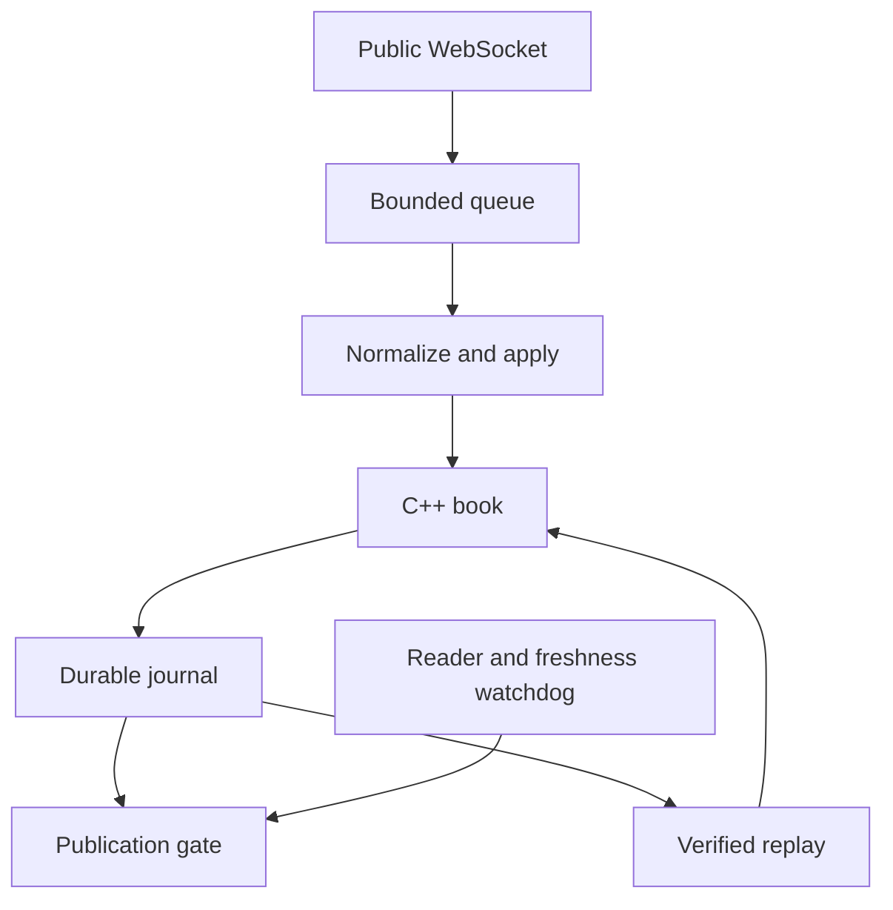

# Design and correctness

## Data flow

The public WebSocket subscribes to one product's `level2` and `heartbeats` channels. Python owns transport, normalization, supervision, recording, and replay. A persistent C++20 subprocess owns the order book. There is one command writer, so ordering is explicit and the book needs no locks.

The reader has its own task and the journal writer runs on a dedicated thread. A blocked commit therefore does not prevent the reader or watchdog from closing the publication gate. Quote callbacks run synchronously and must remain short and nonblocking.

## When state is trusted

| State | Incoming action | Result |
| --- | --- | --- |
| Cold or invalid | Start a new connection generation | Empty book; wait for a snapshot |
| Waiting for snapshot | Sequenced control envelope | Advance continuity, remain untrusted |
| Waiting for snapshot | Valid, contiguous snapshot | Build full depth, commit result, open gate |
| Trusted | Next update | Apply absolute quantities atomically, commit, publish |
| Trusted | Next control envelope | Advance continuity; do not publish a quote |
| Trusted | Duplicate or older sequence | Ignore without changing levels |
| Any active connection | Gap, invalid frame, disconnect, overflow, stale work | Close gate; invalidate; discard queued work |
| Invalid | Old connection update or snapshot | Reject; require a new connection generation |
| Any | Persistent recording failure | Stop; keep gate closed |

Every connection gets a monotonically increasing local generation. A reset must move to a higher generation; commands from another generation cannot mutate or invalidate the current book.

## Sequence interpretation

Incoming `channel: l2_data` messages contain `sequence_num`. During live integration, subscription replies and heartbeat messages also consumed positions in the same connection sequence. Filtering those envelopes before checking continuity caused false gaps, so the adapter records them as `TICK` commands.

For example: snapshot 0, update 1, subscription 2, heartbeat 3, update 4 is contiguous. `TICK` advances the sequence without altering depth or republishing prices. A real missing envelope still invalidates state. This behavior is covered by a local WebSocket integration test with controls before the initial snapshot and between updates.

`heartbeat_counter` is a separate field and is not used as the sequencing source. The collector only subscribes to a single product; supporting multiple products needs an explicitly designed sequencing and ownership model.

## Price levels and arithmetic

Price and size are decimal strings parsed into signed 64-bit integer units with scale `100,000,000`. The parser rejects negative values, floats, exponent notation, overflow, and nonzero digits beyond eight decimal places. Extra trailing zeroes are accepted; values are never rounded silently.

An update's `new_quantity` is an absolute size, not a delta. Size zero removes a price level. The C++ book uses `std::map` on each side: O(log L) insertion/deletion and direct best-price lookup. This favors straightforward full-depth correctness over a specialized flat price ladder.

The entire envelope is one batch. All fields are validated before applying it, and no intermediate quote is emitted while the batch changes levels. A crossed or locked final book is invalidated. The two sides may legitimately be empty, in which case the corresponding quote is null. Combined depth is limited to 250,000 levels.

## Backpressure and freshness

There are two application queue bounds: maximum messages and raw UTF-8 bytes. Defaults are 256 messages and 16 MiB. The WebSocket transport also uses a bounded receive queue (`max_queue=1`) and an 8 MiB frame limit.

An overloaded collector must not silently drop arbitrary updates or accumulate unlimited lag. When the queue is full, the reader immediately closes the gate and reconnects for a new snapshot. Retry delays use exponential backoff and jitter after recoverable session faults. A configured total reconnect budget bounds repeated failures.

The freshness watchdog independently monitors the oldest queued frame and the frame currently being processed. Defaults are 500 ms maximum local lag, 10 seconds without incoming frames, and 15 seconds to obtain a snapshot. It can close the gate while a slow native request or disk commit is in flight. A completed old request is checked against that closed gate before any publication.

These are client receive-time deadlines, not exchange event-time guarantees. Exchange timestamps are retained in raw frames but local wall clocks are not assumed synchronized to the venue.

## Recording and cancellation

SQLite uses WAL and `synchronous=FULL`; each command is committed separately. A journal record contains the raw envelope, exact normalized command, result, receive timestamp, and a SHA-256 chain link. Metadata records the schema and fixed-point scale. Files are exclusive-create and have a storage budget.

Applying a native command and recording its result is one cancellation unit. Once it begins, shutdown waits for the pair to finish. This prevents a native mutation from disappearing from an otherwise replayable journal because its task was canceled mid-commit. The native request wrapper similarly preserves stdin/stdout reply alignment during cancellation.

A failed commit permanently poisons the recorder. Publication closes and the process stops; it does not continue appending later commands after an unrecorded mutation. Replay can reconstruct the valid committed prefix.

The command is durable before its quote callback. A separate publication marker records quotes that actually passed the gate, so replay does not emit an applied update that was suppressed by a concurrent disconnect. A crash between callback and marker can leave a delivered quote without a marker. This is intentionally not an exactly-once downstream delivery protocol.

## Recovery and research

A reconnect cancels and drains the old session's tasks, closes its gate, resets the native book into a higher generation, and waits for a new snapshot. It does not apply buffered old deltas to a new snapshot or reuse an invalid book.

The new snapshot reconstructs current depth, including changes during the outage. It does not recover the missing historical event path. `generation` is included in all research CSV rows so experiments can split at recovery boundaries rather than treat the sample stream as continuous.

Replay verifies SQLite integrity, row IDs, the SHA-256 chain, raw-to-normalized consistency, and each exact C++ result, including its state fingerprint and counters. Speed zero runs as fast as possible; a positive speed scales recorded receive-time spacing. The state fingerprint is an incremental noncryptographic checksum for regression comparison; the journal hash chain handles record integrity.

## Tradeoffs and next improvements

1. **C++ core, Python orchestration:** fast and testable reconstruction with simple network tooling. Text IPC and JSON add overhead; direct bindings or a binary ring buffer would be the next performance step.
2. **One durable commit per command:** easy ordering and clear publication guarantees. Group commit could improve throughput but needs a defined durability/publication window and careful shutdown tests.
3. **Reconnect on overload:** chooses correctness over availability. Sustained overload requires faster recording/processing or a different pipeline design, not a larger unbounded queue.
4. **Local persistence:** replayable after process interruption, but not resilient to loss of the host or its disk. A replicated log and externally anchored journal head would address that separately.
5. **Short live validation:** the included capture verifies the real protocol and recovery path. It is not a soak test or a capacity estimate for another venue.
